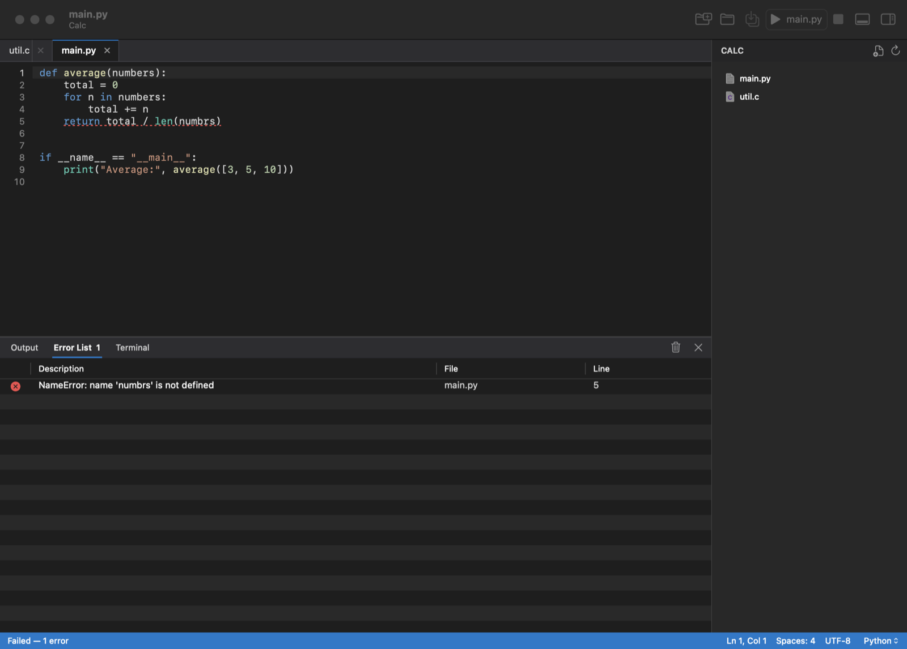

# CodeForge

A small, fast, native IDE for macOS, inspired by Visual Studio: a Start page with project templates, a Solution
Explorer-style file tree, editor tabs, an **Output / Error List / Terminal** panel, and a green **Start** button that
runs your code. The whole app is about **1 MB**, has no third-party dependencies, and updates itself from GitHub
Releases.



- **Native and light.** Written in Swift with AppKit. It starts instantly and runs on Apple Silicon and Intel Macs
  with macOS 14 or later.
- **Visual Studio-style layout.** Toolbox and Server Explorer on the left, Solution Explorer, Git Changes and Class View
  on the right, a docked bottom panel and a colored status bar. Color themes: Light, Dark, Blue, High Contrast, Monokai,
  Dracula and Solarized. The toolbar can be customized (View ▸ Toolbars ▸ Customize…).
- **Start fast.** File ▸ New Project… creates a ready-to-run project for Python, C, C++, Swift, Node.js, TypeScript,
  web pages, Go, Rust or Java. You can also clone a Git repository straight from the Start page.
- **Toolbox, designer and Properties.** A Visual Studio-style Toolbox with HTML controls, Bootstrap components, ASP.NET
  Tag Helpers and C#, VB.NET, SwiftUI, Python and JavaScript snippets (double-click or drag into the editor). HTML pages
  have Design / Split / Source views, and the Properties window edits the attributes of the selected element.
- **Visual Studio menus and tools.** Project ▸ Add New Item, NuGet packages, a Debug/Release configuration box, Test ▸
  Run All Tests, Tools ▸ Options and the Code Snippets Manager.
- **Find and Replace in Files** (⇧⌘F / ⇧⌘H) across the whole project, with match case, whole word, regular expressions
  and file types, and results in a Find Results tab.
- **Refactoring.** Quick Actions and Refactorings (⌥↩), Rename (F2) and Extract Method (⌥⌘M), for every language with a
  language server and, built in, for VB.NET, C#, Python, JavaScript, TypeScript and Swift.
- **Class View and Object Browser.** The project's namespaces, classes and members (⇧⌘C), and an Object Browser (⌥⌘J)
  with your types and common .NET classes.
- **Server Explorer.** Connect to SQLite files, PostgreSQL, MySQL and SQL Server, browse tables, views and columns, show
  table data and run SQL queries (⇧⌘E) with results in a grid.
- **Code snippets.** Type a shortcut such as `prop`, `ctor`, `foreach` or `cw` and press Tab. Add your own in Tools ▸ Code
  Snippets Manager; they also appear in IntelliSense and the Toolbox.
- **.NET.** VB.NET, C#, F# and ASP.NET Core: New Project templates (Razor Pages, MVC, Web API, Empty, gRPC, Blazor,
  Worker Service, .NET MAUI, Avalonia desktop apps with XAML, xUnit/MSTest/NUnit tests, console and class libraries),
  Build and Start with `dotnet`, MSBuild errors in the Error List, C# IntelliSense, VB.NET IntelliSense, and debugging.
- **Many languages.** Syntax highlighting for Swift, Python, JavaScript, TypeScript, C, C++, Objective-C, Java, Kotlin,
  C#, VB.NET, F#, Razor, Go, Rust, Ruby, PHP, Shell, Lua, SQL, HTML/XML, CSS, JSON, YAML, TOML, Markdown, Makefile and Dockerfile.
- **IntelliSense.** Completions, quick info on hover, Go to Definition (F12 / ⌘-click), Find All References (⇧F12),
  Rename (F2) and live error squiggles, powered by standard language servers. VB.NET, which has no language server, gets
  CodeForge's own IntelliSense: member lists from your project and common .NET classes, hover info and Go to Definition.
- **Build and debug.** Build (⇧⌘B) understands Swift packages, Cargo, Go, CMake, Xcode projects, Make and npm.
  Debug C#, VB.NET and F# (netcoredbg), Python (debugpy) and C, C++, Objective-C, Swift, Rust and Go (LLDB): breakpoints (F9), stepping
  (F10 / F11 / ⇧F11), Locals, Call Stack and an expression evaluator.
- **Git built in.** A Git Changes panel to stage, commit, switch branches, pull and push, diffs and history, and the
  branch in the status bar. **CodeLens** shows reference counts and who last changed each function.
- **Run, then fix.** Press ⌘R to run. Output streams into the Output tab, and you can type input for programs that ask
  for it. Compiler and runtime errors appear in the **Error List**. Double-click one to jump to the line, which is
  underlined in the editor.
- **Built-in terminal.** Run `git`, `npm`, `pip` and other commands in the project folder.
- **Editor comforts.** Line numbers, current-line highlight, auto-indent, toggle comment, indent/outdent, find and
  replace, go to line and Quick Open (⌘P).
- **Self-updating.** CodeForge checks GitHub Releases once a day and can install a new version and relaunch.

## Install

1. Download `CodeForge-<version>.zip` from the [latest release](https://github.com/ahmedalbazzaz1987/CodeForge/releases/latest).
2. Unzip it and move **CodeForge.app** to your **Applications** folder.
3. The app isn't notarized by Apple yet, so macOS will block it the first time. Open **System Settings ▸ Privacy &
   Security**, scroll down, and click **Open Anyway** next to the CodeForge message. You only need to do this once;
   updates installed from inside the app don't ask again.

### Build from source

You need Xcode (or the Swift 6 toolchain).

```bash
git clone https://github.com/ahmedalbazzaz1987/CodeForge.git
cd CodeForge
scripts/build-app.sh
open dist/CodeForge.app
```

`swift test` runs the unit tests. To work on the code in Xcode, open `Package.swift`.

## Using CodeForge

| Action | Shortcut |
| --- | --- |
| New project / Add New Item | ⇧⌘N / ⇧⌘A |
| Run All Tests | ⌘U |
| Options | ⌘, |
| Open a file or folder | ⌘O |
| Quick Open (find a file by name) | ⌘P |
| New file / Save / Save All | ⌘N / ⌘S / ⌥⌘S |
| Close tab / next and previous tab | ⌘W / ⇧⌘] and ⇧⌘[ |
| Start without debugging / Stop | ⌘R / ⌘. |
| Build / Clean | ⇧⌘B / ⇧⌘K |
| Start Debugging (or Continue) / Stop Debugging | F5 / ⇧F5 |
| Toggle breakpoint | F9, or click the line-number margin |
| Step Over / Step Into / Step Out | F10 / F11 / ⇧F11 |
| Set the project's run command | ⇧⌘R |
| Show or hide the explorer / bottom panel | ⌘B / ⇧⌘Y |
| Toolbox / Properties window | ⌥⌘X / F4 |
| Output / Error List / Terminal | ⇧⌘U / ⇧⌘M / ⌃` |
| Find / Find and Replace | ⌘F / ⌥⌘F |
| Find in Files / Replace in Files | ⇧⌘F / ⇧⌘H |
| Quick Actions and Refactorings / Extract Method | ⌥↩ / ⌥⌘M |
| Class View / Object Browser / Server Explorer | ⇧⌘C / ⌥⌘J / ⌃⌘S |
| Execute SQL query / Code Snippets Manager | ⇧⌘E / ⌃⌘B |
| Expand a code snippet | type its shortcut, then Tab |
| Go to line | ⌘L |
| Toggle comment / indent / outdent | ⌘/ / ⌘] / ⌘[ |
| Show completions | ⌃Space or Esc |
| Go to Definition / Find All References / Rename | F12 or ⌘-click / ⇧F12 / F2 |
| Git Changes | ⌥⌘G |
| Bigger / smaller text | ⌘+ / ⌘- |

Right-click in the explorer to create, rename, reveal or trash files, or to open a Terminal in that folder. The
language menu in the status bar changes how the current file is highlighted and run.

### IntelliSense

CodeForge talks to standard language servers. The status bar shows which one is active for the current file.

| Language | Server | How to get it |
| --- | --- | --- |
| Swift | SourceKit-LSP | Included with Xcode |
| C, C++, Objective-C | clangd | Included with Xcode |
| Python | Pyright | Click **Install Python IntelliSense…** in the status bar (needs Node.js) |
| JavaScript, TypeScript | TypeScript 7 (`tsc --lsp`) | Click **Install … IntelliSense…** in the status bar (needs Node.js) |
| C# | csharp-ls | Click **Install C# IntelliSense…** in the status bar (needs the .NET SDK) |
| Go | gopls | `go install golang.org/x/tools/gopls@latest` |
| Rust | rust-analyzer | `rustup component add rust-analyzer` |
| VB.NET (and others without a server) | CodeForge's own | Built in |

Servers that CodeForge installs live in `~/Library/Application Support/<bundle id>/LanguageServers`. Find All
References in Swift needs a built Swift package (the index comes from the build).

### Debugging

Press **F5**. For .NET projects (C#, VB.NET, F#, ASP.NET Core), CodeForge builds the Debug configuration and runs the
program under [netcoredbg](https://github.com/Samsung/netcoredbg), Samsung's open-source .NET debugger; the first time,
it offers to download it (about 15 MB) into its own folder. (Microsoft's own .NET debugger is licensed only for
Microsoft's products.) For Python files, CodeForge runs the script under [debugpy](https://github.com/microsoft/debugpy); the
first time, it offers to install debugpy into its own folder (it needs `python3`). For compiled languages, it builds the
project (or the current file) with debug information and starts it under LLDB, using `lldb-dap` from Xcode. When it stops at a breakpoint, the **Debug** tab shows local variables and the call stack,
and you can evaluate expressions.

The first time you debug a compiled program, macOS asks for your password to allow a debugger to control the program (the same prompt
Xcode shows). To skip that prompt for good, run `sudo DevToolsSecurity -enable` once in Terminal.

If CodeForge can't tell which program the build made, it asks once (Debug ▸ Set Program to Debug…).

### Git and CodeLens

Open a folder that's a Git repository and click **Git Changes** at the top of the sidebar (or the branch name in the
status bar). Changed files are listed under *Staged Changes* and *Changes*: use **+** and **−** to stage and unstage,
type a message, and click **Commit**. With nothing staged, **Commit All** commits every change. The arrows fetch, pull
and push. Pushing uses your usual Git credentials (for GitHub, the macOS keychain or `gh auth login`).

CodeLens hints appear after functions and types once a file is saved. Reference counts come from the language server
(IntelliSense must be on for that language) and the author and time come from `git blame`.

### .NET (VB.NET, C#, ASP.NET Core)

Install the .NET SDK once (`brew install dotnet`). Then use **File ▸ New Project…** and pick an ASP.NET Core or
VB.NET/C# template. **Start** (⌘R) runs `dotnet run` for the project, and web apps open in your browser. Build errors from
C# and VB.NET appear in the Error List.

ASP.NET Core uses C# for pages and APIs; VB.NET works for console apps and class libraries. Classic ASP.NET Web Forms
(`.aspx`) and Windows Forms/WPF designers need Windows, so they aren't available on a Mac. For desktop apps with XAML
windows on a Mac, use the **Avalonia** templates (the closest thing to WPF) or **.NET MAUI** (needs
`dotnet workload install maui` and Xcode).

### Server Explorer

Click **Server Explorer** above the Toolbox (or View ▸ Server Explorer), then **+**. SQLite files work out of the box.
PostgreSQL, MySQL/MariaDB and SQL Server use their command-line clients (`brew install libpq`, `brew install
mysql-client`, `brew install sqlcmd`); passwords are kept only until you quit. Double-click a table to see its first 200
rows, or click the query button to open a SQL tab and run it with **Tools ▸ Execute Query** (⇧⌘E).

### How files run

| Language | Command |
| --- | --- |
| Python | `python3 -u file.py` |
| JavaScript / TypeScript | `node file.js` / `npx tsx file.ts` |
| C / C++ / Objective-C | compiled with `clang` / `clang++`, then run |
| Swift | `swift file.swift` |
| Java / Kotlin / C# | `java File.java` / `kotlinc` + `java -jar` / `dotnet run file.cs` |
| Go / Rust | `go run file.go` / `rustc` then run |
| Ruby, PHP, Lua, Shell | `ruby`, `php`, `lua`, `zsh` |
| SQL | `sqlite3` (in memory) |
| HTML, Markdown | opened in your default app |

Commands run in a login shell, so tools installed with Homebrew, nvm or pyenv are found. If a tool is missing, the
console tells you how to install it. Compiled programs are built in `~/Library/Caches/<bundle id>/build`.

## Releasing an update

Version numbers live in `VERSION`, and release notes in `CHANGELOG.md`.

1. Bump `VERSION` (for example `0.1.0` → `0.2.0`) and add a `## 0.2.0` section to `CHANGELOG.md`.
2. Commit and push.
3. Run `scripts/release.sh`. It runs the tests, builds the app, zips it, writes a SHA-256 checksum, tags the commit
   and creates the GitHub release with both files.

Installed copies of CodeForge see the new release within a day, or right away with **CodeForge ▸ Check for
Updates…**. The updater only installs a download whose checksum matches, whose bundle identifier matches, and whose
code signature verifies.

To sign with an Apple Developer ID instead of the default ad-hoc signature, pass
`--sign "Developer ID Application: Your Name (TEAMID)"` to either script.

## Project layout

```
Sources/CodeForgeKit/   Languages, tokenizer, error parsing, templates, build detection, LSP and Git parsing, symbols,
                        refactoring, find in files, snippets, themes, databases (no UI; unit-tested)
Sources/CodeForge/      The AppKit app: window, editor, IntelliSense, debugger, Git panel, explorer, bottom panel, updater
Tests/                  Unit tests for CodeForgeKit
scripts/                build-app.sh, release.sh, make-icon.swift
```

Adding a language means adding one `Language(...)` entry in `Sources/CodeForgeKit/Languages.swift`, with its file
extensions, keywords, comment and string syntax, and run command.

## License

MIT. See [LICENSE](LICENSE).
